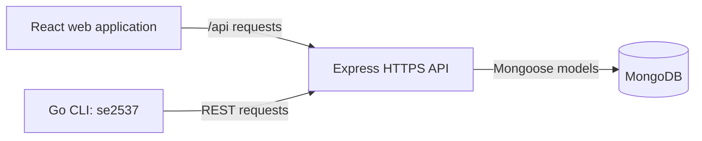

# WattApp

**Find an EV charging station, reserve a charger, and manage charging-point data from the web or command line.**

WattApp is a full-stack university project developed by **Team 37** for the Software Engineering course at the **School of Electrical and Computer Engineering, National Technical University of Athens (NTUA)**. It brings together a React web application, an HTTPS REST API, MongoDB data models, and a Go administration client.

## What you can do

- **Explore charging stations on a map.** Search by location, browse nearby stations, and filter by distance, connector type, and availability.
- **Inspect individual chargers.** View their status, power, connector type, and price per kWh.
- **Reserve an available charger.** Track an active reservation, cancel it, and have overdue reservations expire automatically.
- **Use guest or account access.** Browse as a guest, register and sign in as a customer, or access administrator tools with an admin account.
- **View reservation activity.** See previous reservations and return to a charger's location from your profile.
- **Manage charging-point data.** Run health checks, import points from CSV, restore the supplied point dataset, and update charger status or pricing.
- **Work with charging records.** Create charging sessions and retrieve session or status history through the API and CLI, with JSON or CSV output on supported endpoints.
- **Navigate to a station.** Open directions in Google Maps.

## Technology

| Part | Technologies |
| --- | --- |
| Web application | React 19, TypeScript, Vite 7, React Router |
| Maps | Leaflet, React Leaflet |
| REST API | Node.js, Express, HTTPS |
| Data layer | MongoDB, Mongoose |
| Authentication | bcrypt password hashing and database-backed session tokens |
| Scheduled tasks | node-cron for reservation expiry |
| CLI | Go, Cobra, Resty |
| API testing | Postman collection and Newman |
| Deployment assets | Nginx reverse-proxy configuration |

## Architecture



The web client and CLI share the same API. Controllers implement application operations; the root-level models handle users, authentication sessions, charging points, reservations, charging sessions, and status history. A scheduled task checks for overdue reservations every minute.

## Repository layout

```text
softeng25-37/
├── back-end/api/       Express application, routes, controllers, and HTTPS server
├── front-end/         React application and Vite configuration
├── cli-client/        Go CLI, build scripts, installers, and compiled releases
├── models/            Shared Mongoose models
├── config/            MongoDB connection configuration
├── utils/             Shared date, CSV, and error-response utilities
├── Test/              Postman collection and CSV test fixtures
├── documentation/     Requirements, OpenAPI specification, and diagram sources
├── deployment/nginx/  Reverse-proxy configuration
└── package.json       Dependencies for the shared backend models and utilities
```

## Run locally

### Prerequisites

- **Node.js 22.12 or later** and npm. This satisfies the frontend's Vite dependency requirement.
- **MongoDB with transaction support:** a replica set or MongoDB Atlas. Reservation operations use MongoDB transactions, so a standalone MongoDB instance is insufficient for those operations.
- **Git** and access to this private repository.
- **Go 1.25.5 or later** if you want to build the CLI.

### 1. Clone and install dependencies

```bash
git clone https://github.com/LedgerGhost/softeng25-37.git
cd softeng25-37

npm ci
npm ci --prefix back-end/api
npm ci --prefix front-end
```

Install all three Node.js packages: the API imports models and utilities from the repository root, while the frontend has its own dependencies.

### 2. Configure the database and API

Edit the repository-root `.env` file for your own development environment. For an existing local replica set named `rs0`, a configuration looks like this:

```dotenv
MONGODB_URI=mongodb://127.0.0.1:27017/wattapp?replicaSet=rs0
PORT=9876
NODE_ENV=development
```

Use your own MongoDB connection string if your replica set has a different name or you use Atlas. The API reads this root `.env` file explicitly. `PORT` defaults to `9876`; the server uses HTTPS with the development certificate files in `back-end/api/certs/`.

### 3. Start the API

From the repository root:

```bash
npm start --prefix back-end/api
```

The API starts after connecting to MongoDB. Its default base URL is:

```text
https://localhost:9876/api
```

Check connectivity:

```bash
curl --insecure https://localhost:9876/api/admin/healthcheck
```

Here, `--insecure` accommodates the local development certificate. Use normal certificate verification for a deployment with a trusted certificate.

### 4. Point the frontend at your local API

The committed Vite configuration points to the original hosted API. For local development, change the `/api` proxy in `front-end/vite.config.ts` to:

```ts
proxy: {
  '/api': {
    target: 'https://localhost:9876',
    changeOrigin: true,
    secure: false, // Local development certificate
  },
},
```

Then start the frontend in a second terminal:

```bash
npm run dev --prefix front-end
```

Open the URL printed by Vite, normally `http://localhost:5173`. Frontend requests use the relative `/api` path and are forwarded by the development proxy.

### 5. Create an account and load sample points

Register through the web application. New accounts are created with the `customer` role. Guest access lets you browse without an account.

To use administrative operations in your own development database, an account must have `role: 'admin'` in the `users` collection. There is no automatic admin-account creation in the startup sequence.

Once you have an admin account, use `se2537 resetpoints` or `POST /api/admin/resetpoints` to load the supplied dataset from `back-end/api/utils/resetpointsdata.json`. **This operation replaces the existing charging-point records**, so use it against your development database.

## Command-line client

Build the CLI from source:

```bash
cd cli-client
go build -o se2537 .
./se2537 --help
```

On Windows, build with `go build -o se2537.exe .`. Prebuilt binaries and platform installers are also available in [`cli-client/release/`](cli-client/release/).

The CLI's API base URL is defined by `BaseURL` in `cli-client/cli.go` and defaults to `https://localhost:9876/api`. Change that constant and rebuild if your API runs elsewhere.

Examples, from the `cli-client` directory:

```bash
# Check API and database connectivity
./se2537 healthcheck

# List points as JSON or filter by status
./se2537 points --format json
./se2537 points --status available --format csv

# Inspect or reserve a point that exists in your dataset
./se2537 point --id 2
./se2537 reserve --id 2 --minutes 30

# Retrieve records for a date range
./se2537 sessions --id 2 --from 20260101 --to 20260131 --format json
./se2537 pointstatus --id 2 --from 20260101 --to 20260131 --format csv

# Import charging points from CSV as an administrator
./se2537 addpoints --source ../Test/addpoints.csv
```

Protected commands prompt for credentials when no local token is available. The CLI stores its session token in `.softeng_token` in the current working directory; `./se2537 logout` ends the session and removes that local token file. Use `./se2537 <command> --help` for the flags of each command.

## REST API

The default API base URL is `https://localhost:9876/api`. Protected endpoints expect the session token returned by login in the **`X-OBSERVATORY-AUTH`** header.

| Method | Path, relative to `/api` | Purpose |
| --- | --- | --- |
| `POST` | `/auth/signup` | Register a customer account |
| `POST` | `/auth/login` | Authenticate and obtain a session token |
| `POST` | `/auth/logout` | End an authentication session |
| `GET` | `/auth/me` | Retrieve the current user |
| `GET` | `/points` | List charging points; supports status and output-format queries |
| `GET` | `/point/:id` | Retrieve a charging point |
| `GET` | `/pointsbystation/:lon/:lat/:radius?` | Find nearby stations and their points |
| `POST` | `/USERreserve/:id/:minutes` | Create a user reservation |
| `GET` | `/myreservations` | Retrieve the user's reservations |
| `POST` | `/updpoint/:id` | Update a point's status or price |
| `POST` | `/newsession` | Record a charging session |
| `GET` | `/sessions/:id/:from/:to` | Retrieve charging-session history |
| `GET` | `/pointstatus/:pointid/:from/:to` | Retrieve status-change history |
| `GET` | `/navigate/:pointId` | Redirect to Google Maps directions |
| `GET` | `/admin/healthcheck` | Check database connectivity and point counts |
| `POST` | `/admin/resetpoints` | Replace points with the supplied dataset; admin access required |
| `POST` | `/admin/addpoints` | Import a CSV file using the multipart field `source`; admin access required |

History date parameters use `YYYYMMDD`. Refer to the [OpenAPI specification](documentation/api-doc-open3swagger.yml) and [Postman collection](Test/API-TEST.json) for request bodies, response examples, and additional endpoints. The route files in `back-end/api/routes/` define the current implementation.

## API tests and frontend checks

[`Test/API-TEST.json`](Test/API-TEST.json) contains the Postman collection for authentication, charging-point operations, reservations, sessions, CSV uploads, and invalid-input cases. It includes **39 requests**, some with loops that exercise multiple scenarios.

Start the API against a development database, prepare an admin account, and run the collection from `Test/` so its fixture files resolve correctly:

```bash
cd Test
npx newman run API-TEST.json \
  --bail \
  --insecure \
  --env-var 'baseUrl=https://localhost:9876/api' \
  --env-var 'admintoken=YOUR_ADMIN_SESSION_TOKEN'
```

The collection modifies application data, including resetting and importing points. `--insecure` is intended for the local development certificate. Additional guidance is in [`Test/README.md`](Test/README.md).

From the repository root, the frontend exposes:

```bash
npm run build --prefix front-end
npm run lint --prefix front-end
```

The root Jest configuration is present, but its referenced `setup.js` and matching test suites are not included in this snapshot. The API package's `npm test` script is also a placeholder; the Postman collection is the supplied API test workflow.

## Documentation and deployment

- [Software Requirements Specification](documentation/srs.md): project requirements, use cases, and UML diagrams.
- [OpenAPI specification](documentation/api-doc-open3swagger.yml): API reference.
- [Diagram source backup](documentation/plantuml_codes_backup): diagram sources.
- [Nginx configuration](deployment/nginx/nginx.conf): serves a frontend build and proxies `/api/` to the HTTPS backend.
- [CLI release instructions](cli-client/release/README.md): compiled clients and installation details.

For deployment, build the frontend and adapt the provided Nginx configuration to your server, filesystem paths, and certificate setup. The separate `front-end/server.js` proxy currently targets an HTTP backend, while `back-end/api/server.js` serves HTTPS; align those protocols before using that serving path.

## Academic provenance

This repository is a personal copy of the collaborative [NTUA `softeng25-37` repository](https://github.com/ntua/softeng25-37). The original authors and development branches are preserved in the Git history. Credit belongs to the project team; see the [contributor history](https://github.com/LedgerGhost/softeng25-37/graphs/contributors).

The application is an academic prototype. This README describes the implemented web, API, and CLI workflows; the requirements document provides the wider project context. Component licence notices are preserved, including the [API licence file](back-end/api/LICENSE).
