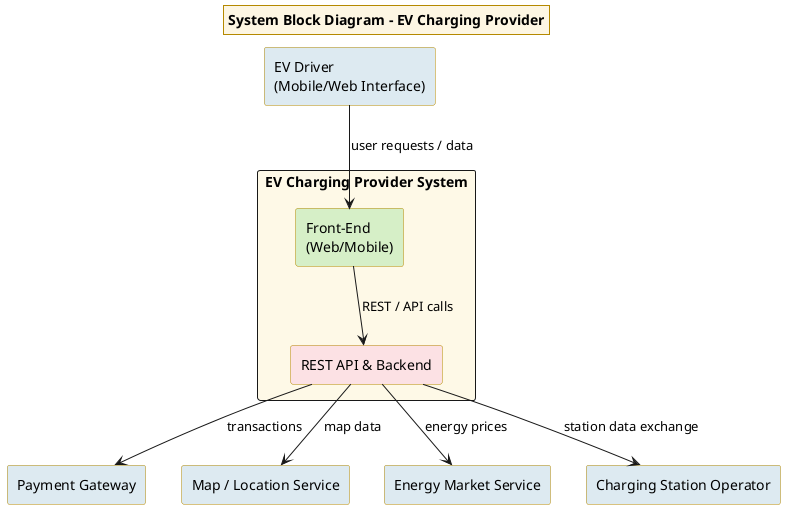
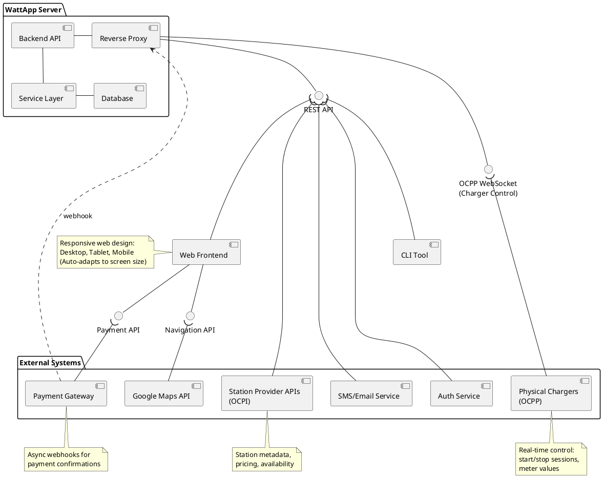
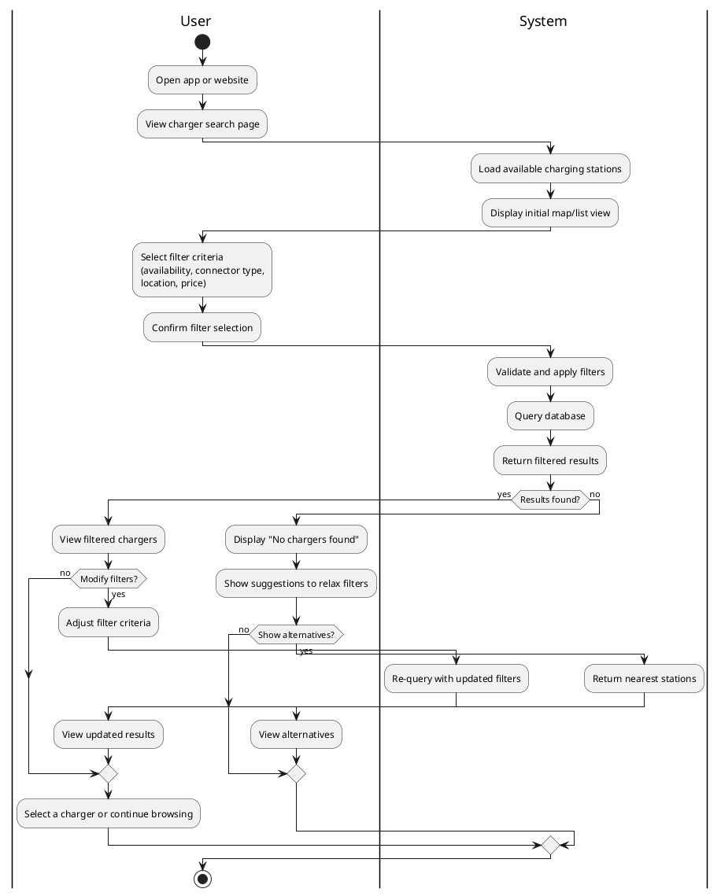
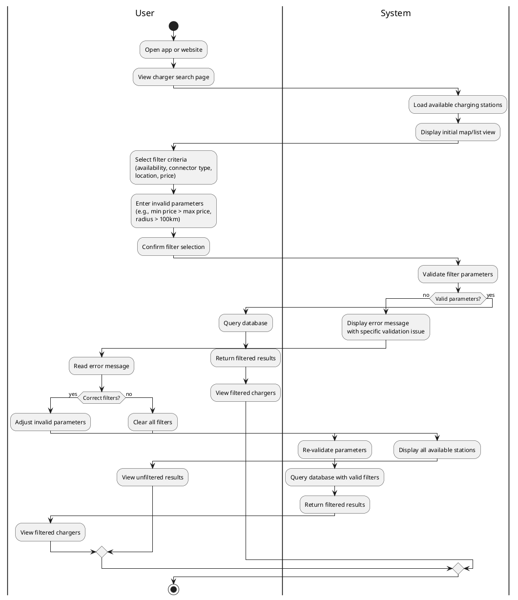
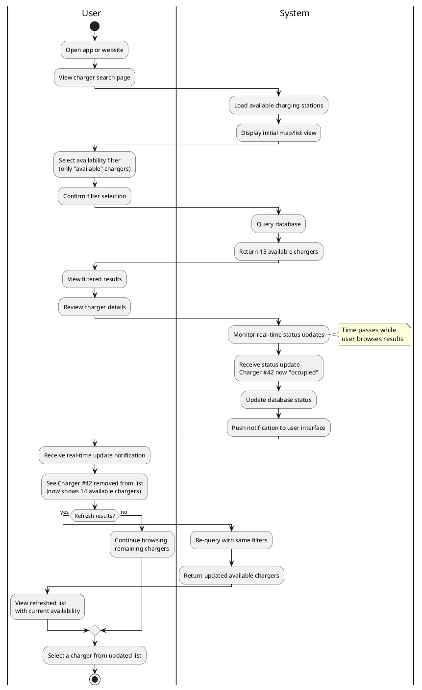
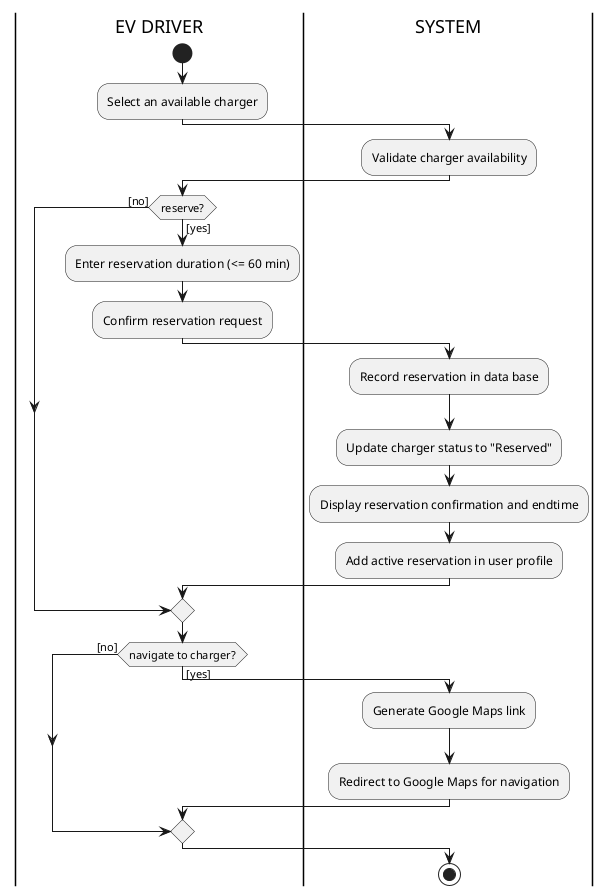
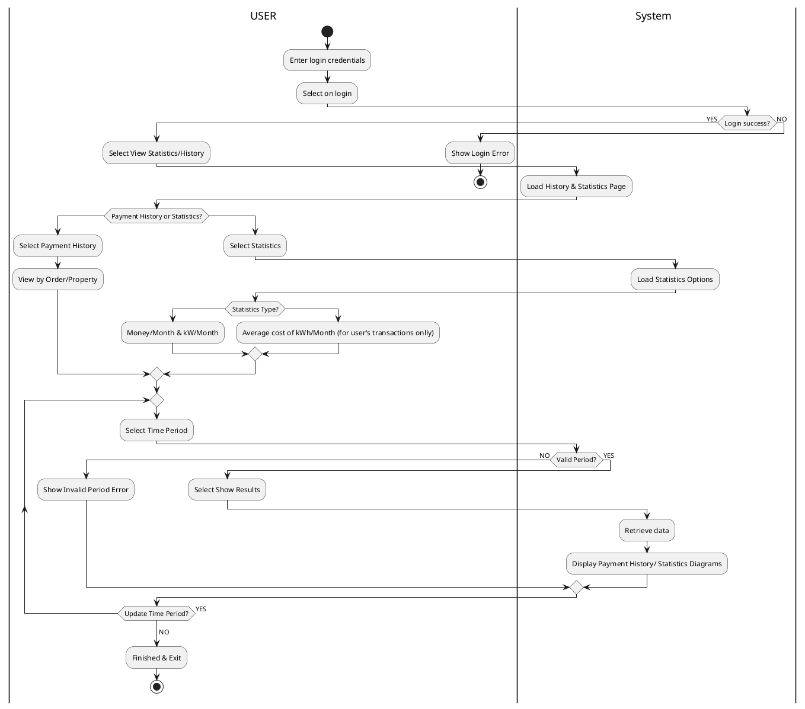
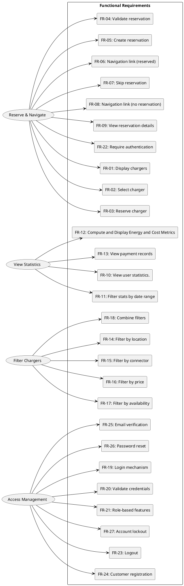
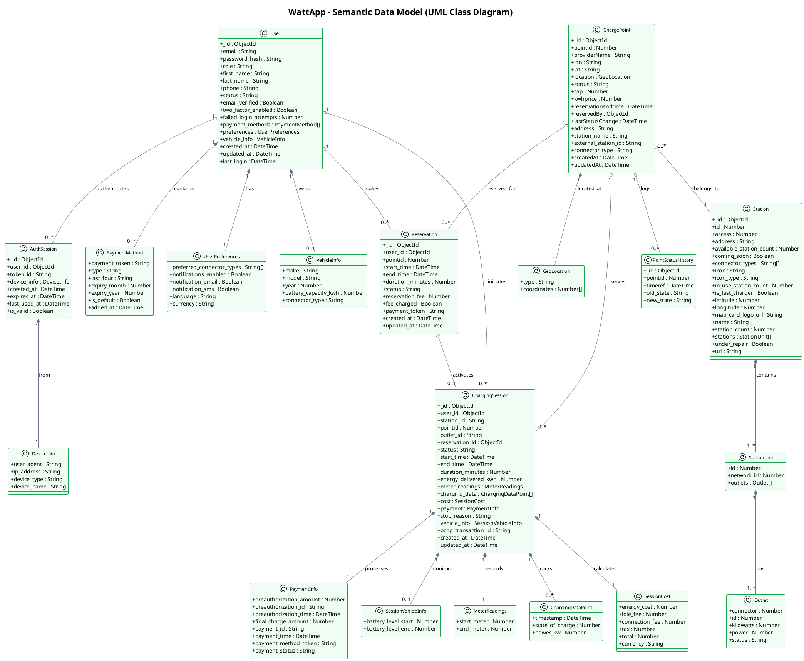

# WattApp
# Software Requirements Specification Document
## 1. Introduction 

### 1.1 Purpose
 
 The purpose of this software system is to provide a unified platform that helps electric-vehicle (EV) drivers locate available charging stations, compare prices and charger characteristics, reserve charging spots when needed, and navigate to them through external map services. The system also offers personalized statistics to each user, such as charging history, energy consumption, cost breakdowns, and trip-related metrics, helping drivers better understand and optimize their charging habits.The overall goal is to improve the convenience, transparency, and usability of public and private EV charging by combining station discovery, reservation management, and personalized user statistics into a single cohesive application.   
      
**Stakeholders**
- EV Drivers (End Users)
  
    Primary users of the system. They search for chargers, compare options, reserve charging spots, receive navigation links, and view their personal charging statistics and history.

- Charging-Station Operators
  
    Provide real-time availability, pricing, and operational status of their chargers to the system. They do not receive statistical analytics from the platform.

- System Administrators
  
    Maintain the platform, manage user authentication/authorization, ensure uptime, and safeguard data integrity and privacy.

- External Service Providers
  
    Third-party systems integrated with the application—for example map/navigation services, payment gateways, and authentication providers.

 **System block diagram**

 

### 1.2 Interfaces

#### 1.2.1 Interfaces to external systems   
WattApp integrates with external services for navigation, payments, charging infrastructure, authentication, and notifications.

**External Systems:**

| System | Purpose | Protocol/Standard |
|--------|---------|-------------------|
| **Google Maps API** | Navigation and routing to charging stations | HTTPS/REST |
| **Payment Gateway** | Process charging session payments | HTTPS/REST, PCI DSS |
| **Station Provider APIs (OCPI)** | Retrieve station metadata and availability | HTTPS/REST, OCPI |
| **Physical Chargers (OCPP)** | Direct control and monitoring of chargers | WebSocket, OCPP 2.1 |
| **Authentication Service** | User authentication and authorization | HTTPS, OAuth 2.0 |
| **SMS/Email Service** | Send notifications and alerts | HTTPS/REST, SMTP |

---

**UML Component Diagram:**

---

**Key Integration Points:**

- **REST API**: Unified HTTPS/REST interface between backend and clients (web, CLI)
- **OCPI (Open Charge Point Interface)**: Protocol for retrieving station metadata, pricing, and availability from charging network operators
- **OCPP (Open Charge Point Protocol)**: WebSocket-based protocol for real-time control and monitoring of physical charging hardware
- **OAuth 2.0**: Standard authentication and authorization protocol for user identity management
- **Async Webhooks**: Payment gateway sends callbacks for transaction confirmations
#### 1.2.2 User Interfaces

**[Figma Wireframes Link](https://www.figma.com/design/wbsxFSCCXe3ZcqxwnqeykU/WattApp-Wireframes?node-id=5-2952&t=cAZzDcldBpT0kh0s-1)**

## 2. References

- Links to information sources.
    -  https://www.ijraset.com/best-journal/ev-charging-station-slot-booking-system
    -  https://driivz.com/blog/ev-charging-standards-and-protocols/
    -  https://www.researchgate.net/publication/380067103_CHARGEEV_AN_EV_CHARGING_STATION_FINDER_BRIDGING_THE_GAP_IN_EV_CHARGING_INFRASTRUCTURE
    -   https://www.plugshare.com
    -   https://www.geeksforgeeks.org/system-design/unified-modeling-language-uml-activity-diagrams/
    -   https://1202performance.wordpress.com/atricles/how-to-write-performance-requirements-with-example/

### Glossary of Terms

| Term | Definition |
|------|------------|
| **EV (Electric Vehicle)** | A vehicle powered fully or partially by electricity and rechargeable batteries. |
| **Charging Station / Charger** | A physical device that supplies electrical energy to charge an EV. |
| **Outlet / Connector** | The specific plug or charging interface on a charger that a user connects their vehicle to. |
| **Charging Session** | A complete charging event that includes start time, end time, consumed energy, and cost. |
| **Reservation** | A temporary booking of a charger or outlet by a user for a specific time window. |
| **Navigation Link / Deep Link** | A generated URL that opens a routing view in an external navigation service (e.g., Google Maps). |
| **Google Maps API** | External service used to generate routes and navigation information. |
| **Payment Gateway** | Third-party service that processes secure online payments for charging sessions. |
| **OCPI (Open Charge Point Interface)** | Standard protocol for exchanging data between charging service providers (pricing, availability, location). |
| **OCPP (Open Charge Point Protocol)** | Standard protocol for communication between physical chargers and backend systems (status, meter values). |
| **Authentication Service** | External identity provider used to authenticate users (e.g., OAuth 2.0). |
| **REST API** | Web service interface using HTTP methods (GET/POST/PUT/DELETE) for communication between frontend and backend. |
| **User Account** | A registered profile allowing access to reservations, statistics, and personalized features. |
| **Statistics Dashboard** | Interface where users view aggregated data about energy usage, cost, and charging history. |
| **Charging Provider System** | Backend system managed by charging-station operators that supplies live data on charger availability and pricing. |
| **System Administrator** | Authorized user responsible for system maintenance, user management, and monitoring. |
| **External Services** | Third-party systems (maps, payments, authentication, notifications) integrated with WattApp. |
| **Session History** | List of past charging sessions stored for analytics and user reference. |
| **Reservation Expiry** | Automatic cancellation of a reservation when the user does not arrive within the reserved time window. |
| **UUID (Universally Unique Identifier)** | 128-bit unique identifier used to distinguish users, chargers, sessions, and reservations in the system. |

    

## 3. Software requirements
 
### 3.1 Τop-level use-case diagram  
The top level use-case model for WattApp is structured around four main actors and their interactions with the system, treating WattApp as a single black-box service. The primary actor, the EV Driver, performs all end-user operations such as searching for charging stations, filtering and comparing options, viewing charger details, reserving chargers, navigating to a station, and accessing personal history and statistics. The Charging Station Operator provides and updates station availability, pricing, and operational status. The System Administrator manages user accounts and system maintenance tasks. External Services, such as payment providers and map/navigation APIs, interact with WattApp through standardized interfaces to support reservations, payments, and routing. The top-level use-case diagram groups driver-focused use cases together and separates operator, administrator, and external-service interactions to show all externally visible system behavior without exposing internal architecture.

```plantuml
@startuml
left to right direction
skinparam actorStyle stickman

' ---- COLORS ----
skinparam rectangle {
  BackgroundColor #fdf6e3
  BorderColor #b58900
}
skinparam actor {
  BackgroundColor #eee8d5
  BorderColor #6c71c4
}
skinparam usecase {
  BackgroundColor #e0f7fa
  BorderColor #00838f
}

actor "EV Driver" as Driver
actor "Charging Station Operator" as Operator
actor "System Administrator" as Admin
actor "External Services" as Ext

rectangle "WattApp" {
  usecase "Search Charging Stations" as UC_Search
  usecase "Filter / Compare Chargers" as UC_Compare
  usecase "View Station Details" as UC_Details
  usecase "Reserve Charger" as UC_Reserve
  usecase "Navigate to Charger" as UC_Navigate
  usecase "View History & Statistics" as UC_Stats
  usecase "Manage Account" as UC_Account

  usecase "Provide Station Data" as UC_StationData
  usecase "Update Charger Status" as UC_Update

  usecase "Manage Users" as UC_AdminUsers
  usecase "Monitor System" as UC_AdminMonitor

  usecase "Process Payment" as UC_Payment
  usecase "Provide Navigation Route" as UC_Map
}

Driver --> UC_Search
Driver --> UC_Compare
Driver --> UC_Details
Driver --> UC_Reserve
Driver --> UC_Navigate
Driver --> UC_Stats
Driver --> UC_Account

Operator --> UC_StationData
Operator --> UC_Update

Admin --> UC_AdminUsers
Admin --> UC_AdminMonitor

Ext --> UC_Payment
Ext --> UC_Map

@enduml
 ```
    

### 3.1 Use cases

#### 3.1.1 Use case 1: Access Management and User Differentiation
##### 3.1.1.1 Roles involved
- Customer/User (EV Driver): Account creation, login, access to charging services.

- Provider Administrator: System management, network monitoring, configuration.

- System: Credential validation and role-based access enforcement.
##### 3.1.1.2 Preconditions
For System:
- System database operational with encrypted user credentials.
- Role definitions and permissions configured.
- Database/server up and functional as well as Internet connection established.

For Customers:
- Valid credentials.

For Administrators:
- Pre-authorized admin account exists (for new admins the original admin needs to change the "role" of the created account from "user" to "admin").

##### 3.1.1.3 Execution enviroment
This use case is executed on the backend of the system, but for all users of the software, the interfaces are:
- Frontend/Web Interface (for both desktop and mobile)
- Command Line Interface (for administrator's functions only)
- Backend REST API to handle the authentication and data retrieval and validation
##### 3.1.1.4 Input data
For Login:
- Email
- Password (min 8 chars, special characters, uppercase letters)

For Registration:
- Email
- Password (2 times -> "password" and "confirm password")
- Phone number
- Full name

##### 3.1.1.5 Expected behaviour

###### Main Flow - Customer Registration:
1)Customer accesses registration page
2)System displays form
3)Customer enters data (email, password, personal info, payment details)
4)System validates format and uniqueness
5)System activates account with "user" role
8)System confirms and redirects to login

###### Main Flow - User Login:
1)User accesses login page
2)System displays login form
3)User enters credentials
4)System validates against database
5)System identifies role (Customer/Administrator)
6)System generates session token
7)System redirects to role-specific dashboard

###### Alternative Flow - Failed Login:
1)Invalid credentials: System increments counter, shows error

###### Access Control (Per Request):
- System validates session token and checks role
- Customer: View/reserve chargers, manage sessions, view billing, manage account
- Administrator: All customer functions plus quick actions in the profile page, full view of all the reservations made by all users
and also access to cli-client for more functions about management of the system

###### UML Activity Diagram
```plantuml
@startuml Login_Activity_Diagram

title Access Management and User Differentiation (LOGIN) Activity Diagram

|#87CEEB|USER|
|#D3D3D3|SYSTEM|
|#90EE90|ADMIN|

|USER|
start

:Access system;

if (has account?) then (yes)
else (no)
  :Click register;
  :Insert registration info;
  
  |SYSTEM|
  :Validate format
  and parse data;
  :Assign token;
  :Insert into db;
  
  if (new user type) then (admin)
    |ADMIN|
    :Update "role"
    field in db;
    |SYSTEM|
  else (user)
  endif
  
  :Redirect to login page;
  
  |USER|
endif

:Insert login credentials;

|SYSTEM|
:Validate matching
username and password;

:Redirect to main page;

if (user type/role) then (user)
  |USER|
  :Navigate to user "profile"
  dashboard;
else (admin)
  |ADMIN|
  :Navigate to admin
  profile dashboard;
endif

stop

@enduml
```

##### 3.1.1.6 Output data and postconditions
**The data that will be viewable to the user:**
Redirection to role main page
Unsuccessful login/register message 

All of the output data are for logging purposes. The access management and user differentiation happens in the backend and no visible data are provided to the user, just redirection to the main page, meaning that the user differentiation for the two types is visible in the "profile" page.

**The data that are created as output (as mentioned for logging purposes) but remain hidden to the user, are:**
- Session token/JWT with expiration
- User profile: user_id, role, permissions, account status, last_login, timestamps & all the relative information that are filled in by the user in the "signup" page
- Auth session logs as shown in the class diagram at the end of the document.

##### 3.1.1.7 Notes
- Passwords hashed using bcrypt or SCRAM-SHA-256
- HTTPS required for all communications
- GDPR compliance for personal data ()
- CLI uses API keys/OAuth tokens

#### 3.1.2 Use case 2: Filter Charging Stations

The user accesses the web app to search for charging stations and applies filters to narrow results based on specific criteria. The system allows filtering by availability status, charger type (connector type), location/proximity, and price. Users can combine multiple filters to find chargers matching their vehicle specifications and preferences. The system dynamically updates the displayed results as filters are applied. 
##### 3.1.2.1 Roles involved
 -  User : Searches for chargers and applies filters

 -  System: Retrieves charger data, applies filters, and returns matching results

 -  Charging Provider System: Provides real-time charger status and metadata
##### 3.1.2.2 Preconditions
- The user has access to the web or mobile interface.  
- The system is successfully connected to station provider APIs (OCPI sources).  
- Charger data (availability, type, and location) is cached or retrievable from the backend.  
##### 3.1.2.3 Execution enviroment
- **User interfaces:** Web frontend and mobile application — map and list-based station discovery screens.  
- **Backend REST API:** Handles filter queries, interacts with the provider APIs, and returns filtered lists.  
- **Database system:** Maintains cached metadata for charger types and current availability snapshots.  
##### 3.1.2.4 Input data
| Parameter | Type | Description |
|------------|------|-------------|
| `user_id` | UUID | Unique identifier of the logged-in user |
| `location_area` | GEOJSON / LAT-LON | Geographic bounds or map viewport |
| `availability_filter` | ENUM | {"Available", "InUse", "Offline", "All"} |
| `charger_type_filter` | ENUM or LIST | {"AC_Type2", "DC_Fast", "CHAdeMO", "CCS"} |
| `sort_order` | ENUM | {"distance", "price", "power"} (optional) |
##### 3.1.2.5 Expected behaviour
###### Main flow

###### Alternate flows
### Invalid filter parameters

- **Offline Data Mode**  

  
##### 3.1.2.6 Output data and postconditions
**Output data**
- `filtered_chargers[]`: Array of charger objects, each containing  
  - charger_id, location, price_per_kWh, power_kW, availability_status, charger_type.  
- `filter_summary`: Object containing applied filters and result count.
**Postconditions**
- The filtered list/map view reflects the user’s last selected filters.  
- Filter state is stored (temporarily in session) so that navigation between pages retains results.  
- The system logs user filter actions for analytics.
##### 3.1.2.7 Notes
- Filters may be combined with other discovery criteria (e.g., pricing range, operator, network).  
- Future extensions may include “charger power ≥ X kW” or “preferred network only.”  
- This use case supports both anonymous (guest) and authenticated users.

#### 3.1.3 Use case 3: Reserve and Navigate to Charger
The user selects an available charger, and optionally reserves it for a specific duration.
After reserving, the user can choose to open navigation to that charger via an external service (e.g., Google Maps).
The system validates reservation rules, records the booking, and provides navigation options.
##### 3.1.3.1 Roles involved

-User : selects and optionally reserves a charger, initiates navigation

-Charging Provider System : manages charger availability, reservations, and navigation linking

-Navigation Service : external service used for route guidance

##### 3.1.3.2 Preconditions
-The user is already logged in to an existing account

-The provider’s charging network and backend services are operational.

-The user has installed and can access the provider’s web or mobile application.

-At least one physical charger is online and functional.

##### 3.1.3.3 Execution enviroment
<!--[ 
    - Web frontend, smartphone ui, api execution context
    - For user interfaces: add wireframes as plantuml/salt, mermaid.js/"user journey", or D2        
]-->
-User interfaces: Web frontend and mobile app (guest browsing and logged-in actions).

-Backend REST API: Manages authentication, reservations, and integration with Google Maps deep links

-Database system: Stores charger data and reservation records

-External service: Google Maps for routing

##### 3.1.3.4 Input data
- HTTP Header `X-OBSERVATORY-AUTH`: STRING (required) — Authentication token; identifies the logged-in user.
- Path parameter `id`: INTEGER (required) — Charging point ID (`pointid`) to reserve.
- Path parameter `minutes`: INTEGER (optional, range 1-60, default 30) — Reservation duration in minutes.
- Request body: none (reservation inputs are passed via header + path parameters).

##### 3.1.3.5 Expected behaviour

###### Main flow

##### 3.1.3.6 Output data and postconditions

*Output data*
    
-reservation_response: Object (from `POST /api/USERreserve/{id}` or `POST /api/USERreserve/{id}/{minutes}`)
    
 - pointid: INTEGER — Reserved charging point ID
 - status: ENUM {"reserved", "charging", "malfunction", "offline", "available"} — Current point status after reservation attempt
 - reservationendtime: STRING (format `YYYY-MM-DD HH:mm`) — Reservation end time; returns `"1970-01-01 00:00"` when point is not reservable
    
-navigation_response: HTTP redirect (from `GET /api/navigate/{pointId}`)
    
 - status_code: 302 — Redirect to external navigation service
 - location: STRING — Google Maps URL in `Location` header (`https://www.google.com/maps/dir/?api=1&destination=lat,lon`)
 - response_body: none (on success)
    
*Postconditions*
    
 - Reservation is recorded in the database if selected.
 - The user is redirected to Google Maps for navigation (if chosen).
 - Charger status updates to Reserved for the reservation duration.
 - The user can view the reservation details in their account.

#### 3.1.4 Use case 4: History & Statistics
The user logs into the web app and navigates to view their charging statistics and payment history. The user can filter data by time period, view different types of statistics (energy consumption, costs, payment records), and analyze their charging patterns over time. The system retrieves historical data and presents it in an organized format.

##### 3.1.4.1 Roles involved
-User : Views personal charging statistics and payment history

-System: Retrieves and aggregates historical data, validates time periods, generates statistics

##### 3.1.4.2 Preconditions
-The user has a registered account in the system

-The user has completed at least one charging session (for meaningful statistics)

-The backend services are operational

#### 3.1.4.3 Execution enviroment

-User interfaces: Web frontend and mobile app (guest browsing and logged-in actions).

-Backend REST API: Handles authentication, data retrieval, aggregation, and time period validation

-Database system: Stores charging sessions and payment records

#### 3.1.4.4 Input data
- user_id: UUID — Unique identifier of the logged-in user 
- time_period_start: DATETIME — Start date/time for statistics query
- time_period_end: DATETIME — End date/time for statistics query
- view_type: ENUM — Type of view requested:
    1. "payment_history" — View payment records
    2. "statistics_energy_cost" — View money/month and kW/month
    3. "statistics_avg_cost" — View average cost per kWh/month

##### 3.1.4.5 Expected behaviour

##### 3.1.4.6 Output data and postconditions
*Output data*

For Payment History view:
- payment_history_list: Array of payment records (all sessions in selected period)

    - payment_id: UUID — Unique identifier of payment
    - session_id: UUID — Associated charging session
    - station_name: STRING — Name of charging station
    - date: DATETIME — Payment date
    - energy_kwh: DECIMAL — Energy consumed
    - cost: DECIMAL — Total cost
    - payment_method: STRING — Payment method used
    - status: ENUM {"completed", "pending", "failed"}

- summary_totals: Object

    - total_cost: DECIMAL — Sum of all payments in period
    - total_sessions: INTEGER — Number of sessions

For Statistics (Money/Month & kW/Month) view:
- summary_per_month: Array of monthly aggregations (one entry per month in selected period)

    - month: STRING — Month identifier (e.g., "2025-09", "2025-10", "2025-11")
    - total_energy_kwh: DECIMAL — Total energy consumed in that month
    - total_cost: DECIMAL — Total cost for that month
    - session_count: INTEGER — Number of sessions in that month

For Statistics (Average cost of kWh/Month) view:

- monthly_averages: Array of monthly calculations (one entry per month in selected period)

    - month: STRING — Month identifier (e.g., "2025-09", "2025-10", "2025-11")
    - avg_cost_per_kwh: DECIMAL — Average cost per kWh for that month
    - sample_size: INTEGER — Number of sessions used in calculation for that month

*Postconditions*

- User successfully views their requested statistics or payment history
- No data modifications occur (read-only operation)
- User session remains active
- User can continue to adjust filters and view updated results

##### 3.1.4.7 Notes 
Performance Considerations:

- For users with extensive history (1000+ sessions), implement pagination to avoid loading all records simultaneously
- Consider pre-computing common aggregations (monthly totals) to improve response times

User Experience:

- Default time period should be the last 30 days or current month
- Display loading indicators during data retrieval and aggregation
- Show empty state with helpful message when no data exists

Future Enhancements:

- Export statistics to CSV/PDF format
- Add graphical visualizations (charts, graphs) for trend analysis
- Implement comparison views (e.g., "vs. previous period")
- Provide preset options for common periods ("Last 7 days", "This month", "Last 3 months", "This year")
- Add filtering by specific station, charger type, or location

## 3.2 Functional Requirements
 
**UML functional requirements diagram**

**Functional Requirements Table**

| Category | ID | Description |
|----------|----|-------------|
| **Reservation & Navigation** | FR-01 | Display available charging stations on a map or list. |
|  | FR-02 | Allow users to select a charger and view its details. |
|  | FR-03 | Allow users to reserve a charger for a chosen duration. |
|  | FR-04 | Validate reservation requests for conflicts and availability. |
|  | FR-05 | Create a reservation and mark the charger as “Reserved.” |
|  | FR-06 | Generate a navigation link to the reserved charger. |
|  | FR-07 | Allow navigation without creating a reservation. |
|  | FR-08 | Generate a navigation link for non-reserved chargers. |
|  | FR-09 | Allow users to view their active reservation details. |
| **Statistics** | FR-10 | The system shall present users with personal charging statistics. |
|  | FR-11 | The system shall allow filtering by date range. |
|  | FR-12 |The system shall compute and display metrics such as total energy consumption, total cost, and average cost. |
|  | FR-13 |The system shall show payment history records. |
| **Filters** | FR-14 | Filter chargers by location or proximity. |
|  | FR-15 | Filter chargers by connector type. |
|  | FR-16 | Filter chargers by price. |
|  | FR-17 | Filter chargers by real-time availability. |
|  | FR-18 | Support combining multiple filter criteria. |
| **Access Management** | FR-19 | Provide login for users and administrators. |
|  | FR-20 | Validate login credentials. |
|  | FR-21 | Show role-appropriate features after login. |
|  | FR-22 | Require authentication for reservation actions. |
|  | FR-23 | Allow authenticated users to log out. |
|  | FR-24 | The system shall allow new users to register by providing at least a unique email and a password, and shall create a corresponding user account with a default role.
|  | FR-25 | Send a verification email after registration and activate the customer account only after successful verification. |
|  | FR-26 | Provide a “forgot password” flow that sends a reset link to the user’s email and allows setting a new password after validation. |
|  | FR-27 | Lock a user account for a defined period (e.g., 15 minutes) after a configured number of consecutive failed login attempts and notify the user. |

## 3.3 Performance requirements

The performance requirements PR-01 to PR-09 are based on empirical data from EV charger locations in the target region. The dataset contains approximately 545 locations, 1 021 stations, and 1 454 charging outlets. Assuming a typical update frequency of 5–10 seconds per outlet, the backend must handle approximately 150–300 real-time status updates per second. With around 8 700 charging sessions per day (≈10k sessions), reporting queries of this size should be returned within 3 seconds on a properly indexed database. Concurrent user sessions of at least 1 000 are justified by the maximum number of outlets and potential monitoring users.

| **ID** | **Requirement Description** | **Category** | **Priority** |
|:------:|-----------------------------|---------------|---------------|
| **PR‑01** | The web interface shall display charger availability or dashboard pages within **2 seconds** under normal network conditions. | Response Time | High |
| **PR‑02** | The backend API shall respond to charger status or booking requests within **500 milliseconds** for at least 95% of total requests. | API Response | High |
| **PR‑03** | The system shall support at least **1,000 concurrent user sessions** without significant degradation of performance. | Throughput | High |
| **PR‑04** | The system shall be capable of processing and storing up to **200 charging session updates per second** from connected chargers. | Real‑Time Processing | High |
| **PR‑05** | The web application shall maintain a minimum **99.9% uptime** (excluding scheduled maintenance). | Availability | High |
| **PR‑06** | System recovery after an unexpected failure shall occur automatically within **60 seconds**. | Reliability / Recovery | High |
| **PR‑07** | The architecture shall allow **horizontal scaling** (e.g., adding servers or containers) to handle at least **double the normal load** without redesign. | Scalability | Medium |
| **PR‑08** | Updates from physical chargers (status changes, session data) shall be reflected on the user dashboard within **5 seconds** of being received. | Data Freshness / Synchronization | High |
| **PR‑09** | The system shall retrieve reports or usage summaries of up to 10,000 charging sessions within **3 seconds**. | Database Query Performance | Medium |

---

## 3.4 Data requirements

### 3.4.1 Data access requirements

The data organization is based on a **document-oriented model** using MongoDB, where each collection stores JSON documents with a unique identifier `_id` (ObjectId) for record identification. Primary collections include `users`, `stations`, `reservations`, `charging_sessions`, `auth_sessions`, and `audit_logs`.

---

#### **Relationships and References**

MongoDB does not enforce referential integrity through foreign keys. Relationships are implemented through:

**1. References**: ObjectIds linking documents across collections (e.g., `reservations.user_id` → `users._id`)

**2. Embedded Documents**: Nested data for tightly coupled information (e.g., `stations.outlets[]` array)

**3. Snapshots**: Duplicated data to preserve historical accuracy (e.g., `charging_sessions.station_name`)

---

#### **Data Integrity Requirements**

Since MongoDB lacks database-level constraints, integrity is enforced at the application layer:

1. **Pre-Write Validation**: Verify referenced documents exist before creating relationships
2. **Uniqueness Constraints**: Unique indexes prevent duplicates (e.g., `users.email`)
3. **Value Constraints**: Enforce business rules (e.g., `energy_kwh > 0`, `end_time > start_time`)
4. **Optimistic Locking**: Version fields detect concurrent modifications
5. **Atomic Operations**: Use `findOneAndUpdate` with conditions for critical state changes
6. **Transactions**: Multi-document transactions for operations requiring cross-collection consistency

---

#### **Indexes for Performance**

Required indexes to optimize queries:

| Collection | Index | Purpose |
|-----------|-------|---------|
| `users` | `{ email: 1 }` (unique) | Fast lookup, prevent duplicates |
| `stations` | `{ location: "2dsphere" }` | Geospatial queries for nearby stations |
| `stations` | `{ "outlets.status": 1 }` | Filter available outlets |
| `reservations` | `{ station_id: 1, outlet_id: 1, status: 1 }` | Check reservation conflicts |
| `charging_sessions` | `{ user_id: 1, start_time: -1 }` | User history (newest first) |
| `auth_sessions` | `{ token_id: 1 }` | Token validation |

---

#### **Preventing Duplicate Records**

To avoid duplicate entries, the system employs:

- **Unique Indexes**: Database-level enforcement on key fields (e.g., email)
- **Temporal Overlap Validation**: Before creating a reservation, query for active reservations on the same outlet with overlapping time periods. If found, reject with "Outlet already reserved."
- **Idempotent Operations**: Use `upsert` with unique keys for safely retryable operations

---

#### **Normalization Strategy**

**Normalized** (separate collections): Users, stations, reservations, charging sessions—maintains single source of truth for frequently-changing data.

**Denormalized** (embedded/duplicated): Outlets embedded in stations (always queried together), station snapshots in sessions (historical accuracy), precomputed statistics (performance).

---

#### **Authentication and Authorization**

**Database Level**: 
- Role-based access control (RBAC) with roles: `app_service` (read/write), `readonly` (analytics), `admin` (DBA)
- SCRAM-SHA-256 authentication with TLS 1.2+ encryption

**Application Level**:
- Users access only their own data (filtered by `user_id`)
- Admins scoped to their `provider_id`
- All access logged in `audit_logs` collection
- JWT tokens with 24h (customer) / 8h (admin) expiration

### 3.4.2 Semantic data model
###### Database ER-Diagram

Exactly below follows the ER-diagram of our database. It is the final form of what we have designed and provides the semantics of the data as well as the types for some clarification. Since our database is a NoSQL database all the checking to the types are done via an ODM layer we added with mongoose. The arrays and objects are fully expanded here to show reference but the diagram is in a simplified form in Visual Paradigm for ease of understanding. It is important to have in mind that with the mongoose schem and with the endpoints of the APIs some of the data are null and that we are not checking the added Arrays and Objects since they lack functionality. They are added as data to the database only for scalability purpsoses providing a better picture of a real life scenario application such as this one.

]

## 3.5 Other requirements
### 3.5.1 Availability

The system shall maintain high availability to ensure continuous service for EV charging operations:

| **ID** | **Requirement Description** | **Justification** |
|:------:|----------------------------|-------------------|
| **AV-01** | The system shall maintain **99.9% uptime** (excluding scheduled maintenance windows). | EV charging is a critical service where users rely on immediate availability. Any downtime directly affects user experience, operational reliability, and revenue. A 99.9% uptime requirement permits approximately 8.76 hours of unscheduled downtime per year, allowing limited time for emergency maintenance, troubleshooting, and critical updates. |
| **AV-02** | Scheduled maintenance windows shall not exceed **4 hours per month** and must be announced at least **72 hours in advance**. | Predictable maintenance windows allow users to plan charging sessions and minimize service disruption. The 72-hour notice period ensures users can adjust their schedules accordingly. |
| **AV-03** | The system shall implement **automatic failover** for critical backend services within **60 seconds** of failure detection for redundancy (multiple servers handling the same service with a load balancer distributing traffic). | Charging sessions in progress must not be interrupted by single-point failures. Automatic failover ensures continuity of service and prevents revenue loss from incomplete sessions. |
| **AV-04** | The database shall implement **real-time replication** with at least one standby instance. | Data persistence is critical for billing, session history, and user accounts and legal regulations. Real-time replication protects against data loss and enables rapid recovery. |
| **AV-05** | The payment service interface shall implement **retry logic** with exponential backoff for failed transactions (up to 3 attempts within 30 seconds). | Temporary network issues or payment provider timeouts should not immediately fail charging sessions. Retry logic improves transaction success rates while preventing excessive API calls. |
| **AV-06** | The system shall maintain **degraded operation mode** when external services (maps, third-party APIs) are unavailable, with core charging functions remaining operational. | External service failures should not prevent users from accessing core charging functionality. Degraded mode allows charging to continue while non-critical features are temporarily disabled. |
| **AV-07** | Health monitoring endpoints shall be available for all backend services, reporting status every **30 seconds**. | Proactive monitoring enables rapid detection and resolution of service degradation before users are impacted. Frequent health checks support automated alerting and failover decisions. |

The availability requirements are designed to support a network of approximately 1,454 charging outlets serving around 8,700 daily charging sessions. Any significant downtime would impact hundreds of users and result in substantial revenue loss for the charging provider.

### 3.5.2 Security

The system shall implement comprehensive security measures to protect user data, financial transactions, and system integrity:

| **ID** | **Requirement Description** | **Justification** |
|:------:|----------------------------|-------------------|
| **SEC-01** |All state-changing or sensitive API endpoints (reservations, payments, user data, provider stats) shall require authentication. Read-only station discovery may be accessed without authentication.| Prevents unauthorized access to user accounts, charging sessions, and payment information. Token-based authentication supports stateless API design and session management across devices. |
| **SEC-02** | All data transmission between client applications and backend services shall use **TLS 1.3 or higher** encryption. | Protects sensitive data (credentials, payment information, personal data) from interception during transmission. TLS 1.3 provides improved security and performance over earlier versions. |
| **SEC-03** | User passwords shall be hashed using **bcrypt or Argon2** with appropriate salt and minimum **8-character length** requirement enforced. | Password hashing prevents credential exposure in case of database breach. Bcrypt/Argon2 are industry-standard algorithms resistant to brute-force attacks. Minimum length ensures reasonable password strength. |
| **SEC-04** | Payment-related data shall comply with **PCI DSS** requirements. The system shall **not store** raw credit card numbers or CVV codes. | PCI DSS compliance is legally required for handling payment card data. Tokenization via payment service providers eliminates the need to store sensitive card data and reduces security risk. |
| **SEC-05** | API endpoints shall implement **rate limiting** of maximum **100 requests per minute per user** to prevent abuse and DDoS attacks. | Prevents malicious users from overwhelming the system or conducting credential-stuffing attacks. Rate limiting protects system resources and ensures fair access for legitimate users. |
| **SEC-06** | The system shall implement **role-based access control (RBAC)** distinguishing between regular users, administrators, and system operators. | Different user types require different access levels. RBAC ensures users can only perform authorized actions and access appropriate data, following the principle of least privilege. |
| **SEC-07** | All authentication attempts, payment transactions, and administrative actions shall be **logged** with timestamp, user ID, IP address, and outcome. | Comprehensive logging enables security auditing, fraud detection, and compliance verification. Logs support incident investigation and forensic analysis. |
| **SEC-08** | The system shall implement **session** of 24h customers, 8h admins. | Automatic session expiration reduces risk from unattended devices. Longer sessions balance security with user convenience for frequently accessed apps. |
| **SEC-09** | User data shall be stored in compliance with **GDPR** requirements, including data minimization, purpose limitation, and the right to erasure. | GDPR compliance is legally required in the EU. Users must have control over their personal data, and the system must only collect necessary information. |
| **SEC-10** | SQL injection, XSS, and CSRF attacks shall be prevented through **input validation, parameterized queries, and CSRF tokens**. | These are common attack vectors for web applications. Prevention measures protect against data theft, unauthorized actions, and malicious script injection. |
| **SEC-11** | Payment pre-authorization tokens received from payment providers shall be **encrypted at rest** using AES-256 encryption. | Payment tokens, while not full card numbers, still represent sensitive data that could be misused if exposed. Encryption at rest adds a layer of protection. |
| **SEC-12** | The system shall implement **two-factor authentication (2FA)** as an optional security enhancement for user accounts. | 2FA significantly improves account security, especially for accounts with stored payment methods. Optional implementation respects user preference while encouraging security best practices. |

The security requirements address the sensitive nature of financial transactions, personal data, and the need to maintain user trust. With payment processing integrated into every charging session and approximately 10,000 daily transactions, robust security measures are essential to protect both users and the charging provider from financial loss, data breaches, and regulatory penalties.
