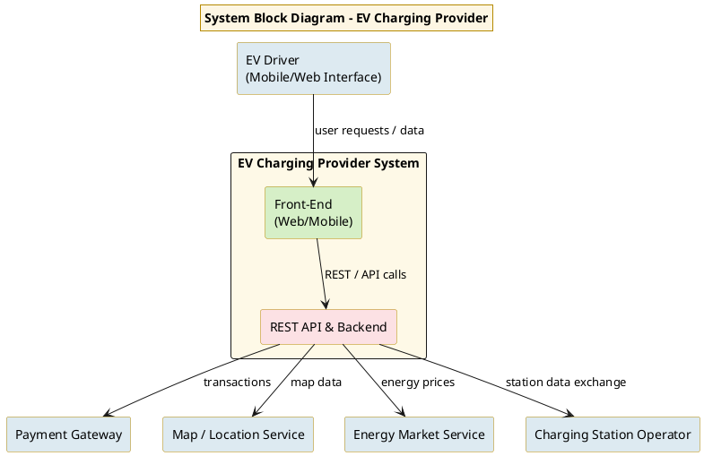
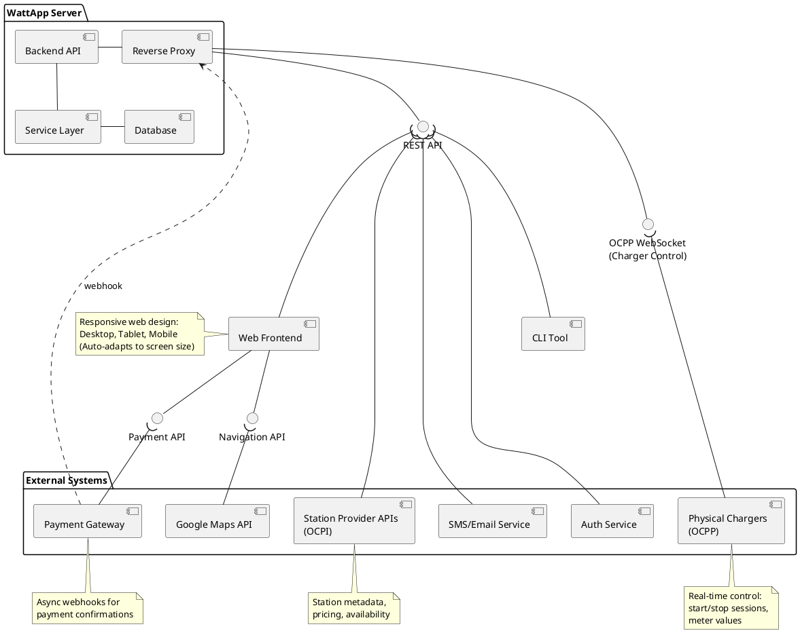
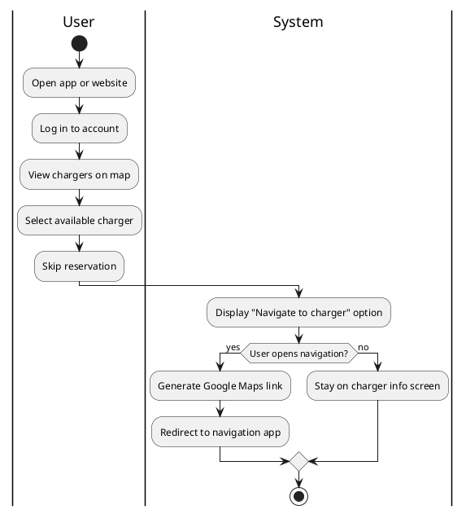
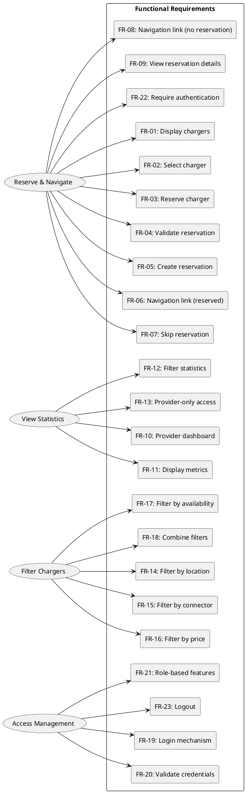

### Software Requirements Specification (SRS) template 2025

# WattApp
# Software Requirements Specification Document
_NOTE: text [in brakets] must not appear in the final SRS document_ 
## 1. Introduction 

### 1.1 Purpose
 
 The purpose of this software system is to provide a unified platform that helps electric-vehicle (EV) drivers locate available charging stations, compare prices and charger characteristics, reserve charging spots when needed, and navigate to them through external map services. The system also offers personalized statistics to each user, such as charging history, energy consumption, cost breakdowns, and trip-related metrics, helping drivers better understand and optimize their charging habits.The overall goal is to improve the convenience, transparency, and usability of public and private EV charging by combining station discovery, reservation management, and personalized user statistics into a single cohesive application.   
      
**Stakeholders**
- EV Drivers (End Users)
  
    Primary users of the system. They search for chargers, compare options, reserve charging spots, receive navigation links, and view their personal charging statistics and history.

- Charging-Station Operators
  
    Provide real-time availability, pricing, and operational status of their chargers to the system. They do not receive statistical analytics from the platform.

- System Administrators
  
    Maintain the platform, manage user authentication/authorization, ensure uptime, and safeguard data integrity and privacy.

- External Service Providers
  
    Third-party systems integrated with the application—for example map/navigation services, payment gateways, and authentication providers.

 **System block diagram**

 

### 1.2 Interfaces

#### 1.2.1 Interfaces to external systems   
WattApp integrates with external services for navigation, payments, charging infrastructure, authentication, and notifications.

**External Systems:**

| System | Purpose | Protocol/Standard |
|--------|---------|-------------------|
| **Google Maps API** | Navigation and routing to charging stations | HTTPS/REST |
| **Payment Gateway** | Process charging session payments | HTTPS/REST, PCI DSS |
| **Station Provider APIs (OCPI)** | Retrieve station metadata and availability | HTTPS/REST, OCPI |
| **Physical Chargers (OCPP)** | Direct control and monitoring of chargers | WebSocket, OCPP 2.1 |
| **Authentication Service** | User authentication and authorization | HTTPS, OAuth 2.0 |
| **SMS/Email Service** | Send notifications and alerts | HTTPS/REST, SMTP |

---

**UML Component Diagram:**

---

**Key Integration Points:**

- **REST API**: Unified HTTPS/REST interface between backend and clients (web, CLI)
- **OCPI (Open Charge Point Interface)**: Protocol for retrieving station metadata, pricing, and availability from charging network operators
- **OCPP (Open Charge Point Protocol)**: WebSocket-based protocol for real-time control and monitoring of physical charging hardware
- **OAuth 2.0**: Standard authentication and authorization protocol for user identity management
- **Async Webhooks**: Payment gateway sends callbacks for transaction confirmations
#### 1.2.2 User Interfaces
[  
    - Use wireframes or any image-based description of UI elements  
    - Use plantuml/salt, mermaid.js/"user journey", or D2  
    - Flow between screens, etc.  
    - No aesthetic details needed  
]   

## 2. References
[  
- Links to information sources.
    -  https://www.ijraset.com/best-journal/ev-charging-station-slot-booking-system
    -  Smart Electric Vehicle Charging System João CFerreira, Vítor Mon teiro, João L. Alonso, Alberto Silva 
Member, IEEE.
    -  https://www.researchgate.net/publication/380067103_CHARGEEV_AN_EV_CHARGING_STATION_FINDER_BRIDGING_THE_GAP_IN_EV_CHARGING_INFRASTRUCTURE
    -   https://www.plugshare.com
    -   https://www.geeksforgeeks.org/system-design/unified-modeling-language-uml-activity-diagrams/

### Glossary of Terms

| Term | Definition |
|------|------------|
| **EV (Electric Vehicle)** | A vehicle powered fully or partially by electricity and rechargeable batteries. |
| **Charging Station / Charger** | A physical device that supplies electrical energy to charge an EV. |
| **Outlet / Connector** | The specific plug or charging interface on a charger that a user connects their vehicle to. |
| **Charging Session** | A complete charging event that includes start time, end time, consumed energy, and cost. |
| **Reservation** | A temporary booking of a charger or outlet by a user for a specific time window. |
| **Navigation Link / Deep Link** | A generated URL that opens a routing view in an external navigation service (e.g., Google Maps). |
| **Google Maps API** | External service used to generate routes and navigation information. |
| **Payment Gateway** | Third-party service that processes secure online payments for charging sessions. |
| **OCPI (Open Charge Point Interface)** | Standard protocol for exchanging data between charging service providers (pricing, availability, location). |
| **OCPP (Open Charge Point Protocol)** | Standard protocol for communication between physical chargers and backend systems (status, meter values). |
| **Authentication Service** | External identity provider used to authenticate users (e.g., OAuth 2.0). |
| **REST API** | Web service interface using HTTP methods (GET/POST/PUT/DELETE) for communication between frontend and backend. |
| **User Account** | A registered profile allowing access to reservations, statistics, and personalized features. |
| **Statistics Dashboard** | Interface where users view aggregated data about energy usage, cost, and charging history. |
| **Charging Provider System** | Backend system managed by charging-station operators that supplies live data on charger availability and pricing. |
| **System Administrator** | Authorized user responsible for system maintenance, user management, and monitoring. |
| **External Services** | Third-party systems (maps, payments, authentication, notifications) integrated with WattApp. |
| **Session History** | List of past charging sessions stored for analytics and user reference. |
| **Reservation Expiry** | Automatic cancellation of a reservation when the user does not arrive within the reserved time window. |
| **UUID (Universally Unique Identifier)** | 128-bit unique identifier used to distinguish users, chargers, sessions, and reservations in the system. |

    
]
## 3. Software requirements
[  
### 3.1 Τop-level use-case diagram  
The top level use-case model for WattApp is structured around four main actors and their interactions with the system, treating WattApp as a single black-box service. The primary actor, the EV Driver, performs all end-user operations such as searching for charging stations, filtering and comparing options, viewing charger details, reserving chargers, navigating to a station, and accessing personal history and statistics. The Charging Station Operator provides and updates station availability, pricing, and operational status. The System Administrator manages user accounts and system maintenance tasks. External Services, such as payment providers and map/navigation APIs, interact with WattApp through standardized interfaces to support reservations, payments, and routing. The top-level use-case diagram groups driver-focused use cases together and separates operator, administrator, and external-service interactions to show all externally visible system behavior without exposing internal architecture.

```plantuml
@startuml
left to right direction
skinparam actorStyle stickman

' ---- COLORS ----
skinparam rectangle {
  BackgroundColor #fdf6e3
  BorderColor #b58900
}
skinparam actor {
  BackgroundColor #eee8d5
  BorderColor #6c71c4
}
skinparam usecase {
  BackgroundColor #e0f7fa
  BorderColor #00838f
}

actor "EV Driver" as Driver
actor "Charging Station Operator" as Operator
actor "System Administrator" as Admin
actor "External Services" as Ext

rectangle "WattApp" {
  usecase "Search Charging Stations" as UC_Search
  usecase "Filter / Compare Chargers" as UC_Compare
  usecase "View Station Details" as UC_Details
  usecase "Reserve Charger" as UC_Reserve
  usecase "Navigate to Charger" as UC_Navigate
  usecase "View History & Statistics" as UC_Stats
  usecase "Manage Account" as UC_Account

  usecase "Provide Station Data" as UC_StationData
  usecase "Update Charger Status" as UC_Update

  usecase "Manage Users" as UC_AdminUsers
  usecase "Monitor System" as UC_AdminMonitor

  usecase "Process Payment" as UC_Payment
  usecase "Provide Navigation Route" as UC_Map
}

Driver --> UC_Search
Driver --> UC_Compare
Driver --> UC_Details
Driver --> UC_Reserve
Driver --> UC_Navigate
Driver --> UC_Stats
Driver --> UC_Account

Operator --> UC_StationData
Operator --> UC_Update

Admin --> UC_AdminUsers
Admin --> UC_AdminMonitor

Ext --> UC_Payment
Ext --> UC_Map

@enduml
 ```
    

### 3.1 Use cases

#### 3.1.1 Use case 1: Access Management and User Differentiation
##### 3.1.1.1 Roles involved
- Customer/User (EV Driver): Account creation, login, access to charging services.

- Provider Administrator: System management, network monitoring, configuration.

- System: Credential validation and role-based access enforcement.
##### 3.1.1.2 Preconditions
For System:
- System database operational with encrypted user credentials.
- Role definitions and permissions configured.
- Database/server up and functional as well as Internet connection established.

For Customers:
- Valid credentials.

For Administrators:
- Pre-authorized admin account exists (for new admins the original admin needs to change the "role" of the created account from "user" to "admin").

##### 3.1.1.3 Execution enviroment
This use case is executed on the backend of the system, but for all users of the software, the interfaces are:
- Frontend/Web Interface (for both desktop and mobile)
- Command Line Interface (for administrator's functions only)
- Backend REST API to handle the authentication and data retrieval and validation
##### 3.1.1.4 Input data
For Login:
- Email
- Password (min 8 chars, special characters, uppercase letters)

For Registration:
- Email
- Password (2 times -> "password" and "confirm password")
- Phone number
- Full name

##### 3.1.1.5 Expected behaviour

###### Main Flow - Customer Registration:
1)Customer accesses registration page
2)System displays form
3)Customer enters data (email, password, personal info, payment details)
4)System validates format and uniqueness
5)System activates account with "user" role
8)System confirms and redirects to login

###### Main Flow - User Login:
1)User accesses login page
2)System displays login form
3)User enters credentials
4)System validates against database
5)System identifies role (Customer/Administrator)
6)System generates session token
7)System redirects to role-specific dashboard

###### Alternative Flow - Failed Login:
1)Invalid credentials: System increments counter, shows error

###### Access Control (Per Request):
- System validates session token and checks role
- Customer: View/reserve chargers, manage sessions, view billing, manage account
- Administrator: All customer functions plus quick actions in the profile page, full view of all the reservations made by all users
and also access to cli-client for more functions about management of the system

###### UML Activity Diagram
```plantuml
@startuml Login_Activity_Diagram

title Access Management and User Differentiation (LOGIN) Activity Diagram

|#87CEEB|USER|
|#D3D3D3|SYSTEM|
|#90EE90|ADMIN|

|USER|
start

:Access system;

if (has account?) then (yes)
else (no)
  :Click register;
  :Insert registration info;
  
  |SYSTEM|
  :Validate format
  and parse data;
  :Assign token;
  :Insert into db;
  
  if (new user type) then (admin)
    |ADMIN|
    :Update "role"
    field in db;
    |SYSTEM|
  else (user)
  endif
  
  :Redirect to login page;
  
  |USER|
endif

:Insert login credentials;

|SYSTEM|
:Validate matching
username and password;

:Redirect to main page;

if (user type/role) then (user)
  |USER|
  :Navigate to user "profile"
  dashboard;
else (admin)
  |ADMIN|
  :Navigate to admin
  profile dashboard;
endif

stop

@enduml
```

###### Alternate flows
*Skip reservation* 

In this alternate flow, the user chooses not to reserve the charger and proceeds directly to navigation. After selecting an available charger from the map, the user skips the reservation step and is immediately presented with the option to open external navigation guidance. The system then generates a Google Maps deep link using the charger’s coordinates and redirects the user to the navigation application without creating a reservation record.

##### 3.1.3.6 Output data and postconditions

*Output data*
    
-reservation_record: Object
    
 - reservation_id: UUID — Unique identifier of reservation
 - user_id: UUID — User who reserved
 - charger_id: UUID — Reserved charger
 - start_time: DATETIME — Reservation start time
 - end_time: DATETIME — Expiration time
 - status: ENUM {"Active", "Expired", "Cancelled"}
    
-navigation_action: Object
    
 - user_id: UUID — User initiating navigation
 - charger_id: UUID — Destination charger
 - maps_link: STRING — Generated Google Maps deep link
 - timestamp: DATETIME — Time navigation link was opened
    
*Postconditions*
    
 - Reservation is recorded in the database if selected.
 - The user is redirected to Google Maps for navigation (if chosen).
 - Charger status updates to Reserved for the reservation duration.
 - The user can view the reservation details in their account.

##### 3.1.3.7 Notes
[  
    - everything else, if needed           
]

#### 3.1.4 Use case 4: History & Statistics
The user logs into the web app and navigates to view their charging statistics and payment history. The user can filter data by time period, view different types of statistics (energy consumption, costs, payment records), and analyze their charging patterns over time. The system retrieves historical data and presents it in an organized format.

##### 3.1.4.1 Roles involved
-User : Views personal charging statistics and payment history

-System: Retrieves and aggregates historical data, validates time periods, generates statistics

##### 3.1.4.2 Preconditions
-The user has a registered account in the system

-The user has completed at least one charging session (for meaningful statistics)

-The backend services are operational

#### 3.1.4.3 Execution enviroment

-User interfaces: Web frontend and mobile app (guest browsing and logged-in actions).

-Backend REST API: Handles authentication, data retrieval, aggregation, and time period validation

-Database system: Stores charging sessions and payment records

#### 3.1.4.4 Input data
- user_id: UUID — Unique identifier of the logged-in user 
- time_period_start: DATETIME — Start date/time for statistics query
- time_period_end: DATETIME — End date/time for statistics query
- view_type: ENUM — Type of view requested:
    1. "payment_history" — View payment records
    2. "statistics_energy_cost" — View money/month and kW/month
    3. "statistics_avg_cost" — View average cost per kWh/month

##### 3.1.4.5 Expected behaviour
[

]

##### 3.1.4.6 Output data and postconditions
*Output data*

For Payment History view:
- payment_history_list: Array of payment records (all sessions in selected period)

    - payment_id: UUID — Unique identifier of payment
    - session_id: UUID — Associated charging session
    - station_name: STRING — Name of charging station
    - date: DATETIME — Payment date
    - energy_kwh: DECIMAL — Energy consumed
    - cost: DECIMAL — Total cost
    - payment_method: STRING — Payment method used
    - status: ENUM {"completed", "pending", "failed"}

- summary_totals: Object

    - total_cost: DECIMAL — Sum of all payments in period
    - total_sessions: INTEGER — Number of sessions

For Statistics (Money/Month & kW/Month) view:
- summary_per_month: Array of monthly aggregations (one entry per month in selected period)

    - month: STRING — Month identifier (e.g., "2025-09", "2025-10", "2025-11")
    - total_energy_kwh: DECIMAL — Total energy consumed in that month
    - total_cost: DECIMAL — Total cost for that month
    - session_count: INTEGER — Number of sessions in that month

For Statistics (Average cost of kWh/Month) view:

- monthly_averages: Array of monthly calculations (one entry per month in selected period)

    - month: STRING — Month identifier (e.g., "2025-09", "2025-10", "2025-11")
    - avg_cost_per_kwh: DECIMAL — Average cost per kWh for that month
    - sample_size: INTEGER — Number of sessions used in calculation for that month

*Postconditions*

- User successfully views their requested statistics or payment history
- No data modifications occur (read-only operation)
- User session remains active
- User can continue to adjust filters and view updated results

##### 3.1.4.7 Notes 
Performance Considerations:

- For users with extensive history (1000+ sessions), implement pagination to avoid loading all records simultaneously
- Consider pre-computing common aggregations (monthly totals) to improve response times

User Experience:

- Default time period should be the last 30 days or current month
- Display loading indicators during data retrieval and aggregation
- Show empty state with helpful message when no data exists

Future Enhancements:

- Export statistics to CSV/PDF format
- Add graphical visualizations (charts, graphs) for trend analysis
- Implement comparison views (e.g., "vs. previous period")
- Provide preset options for common periods ("Last 7 days", "This month", "Last 3 months", "This year")
- Add filtering by specific station, charger type, or location

## 3.2 Functional Requirements
 
**UML functional requirements diagram**

### Functional Requirements Summary

| Category | ID | Description |
|----------|----|-------------|
| **Reservation & Navigation** | FR-01 | Display available charging stations on a map or list. |
|  | FR-02 | Allow users to select a charger and view its details. |
|  | FR-03 | Allow users to reserve a charger for a chosen duration. |
|  | FR-04 | Validate reservation requests for conflicts and availability. |
|  | FR-05 | Create a reservation and mark the charger as “Reserved.” |
|  | FR-06 | Generate a navigation link to the reserved charger. |
|  | FR-07 | Allow navigation without creating a reservation. |
|  | FR-08 | Generate a navigation link for non-reserved chargers. |
|  | FR-09 | Allow users to view their active reservation details. |
| **Statistics** | FR-10 | Provide a dashboard with statistics for service providers. |
|  | FR-11 | Display key metrics such as sessions and utilization. |
|  | FR-12 | Allow filtering of statistics by date range or station. |
|  | FR-13 | Restrict access to statistics to authorized providers. |
| **Filters** | FR-14 | Filter chargers by location or proximity. |
|  | FR-15 | Filter chargers by connector type. |
|  | FR-16 | Filter chargers by price. |
|  | FR-17 | Filter chargers by real-time availability. |
|  | FR-18 | Support combining multiple filter criteria. |
| **Access Management** | FR-19 | Provide login for users and aggregators. |
|  | FR-20 | Validate login credentials. |
|  | FR-21 | Show role-appropriate features after login. |
|  | FR-22 | Require authentication for reservation actions. |
|  | FR-23 | Allow authenticated users to log out. |

## 3.3 Performance requirements

The performance requirements PR-01 to PR-09 are based on empirical data from EV charger locations in the target region. The dataset contains approximately 545 locations, 1 021 stations, and 1 454 charging outlets. Assuming a typical update frequency of 5–10 seconds per outlet, the backend must handle approximately 150–300 real-time status updates per second. With around 8 700 charging sessions per day (≈10k sessions), reporting queries of this size should be returned within 3 seconds on a properly indexed database. Concurrent user sessions of at least 1 000 are justified by the maximum number of outlets and potential monitoring users.

| **ID** | **Requirement Description** | **Category** | **Priority** |
|:------:|-----------------------------|---------------|---------------|
| **PR‑01** | The web interface shall display charger availability or dashboard pages within **2 seconds** under normal network conditions. | Response Time | High |
| **PR‑02** | The backend API shall respond to charger status or booking requests within **500 milliseconds** for at least 95% of total requests. | API Response | High |
| **PR‑03** | The system shall support at least **1,000 concurrent user sessions** without significant degradation of performance. | Throughput | High |
| **PR‑04** | The system shall be capable of processing and storing up to **200 charging session updates per second** from connected chargers. | Real‑Time Processing | High |
| **PR‑05** | The web application shall maintain a minimum **99.9% uptime** (excluding scheduled maintenance). | Availability | High |
| **PR‑06** | System recovery after an unexpected failure shall occur automatically within **60 seconds**. | Reliability / Recovery | High |
| **PR‑07** | The architecture shall allow **horizontal scaling** (e.g., adding servers or containers) to handle at least **double the normal load** without redesign. | Scalability | Medium |
| **PR‑08** | Updates from physical chargers (status changes, session data) shall be reflected on the user dashboard within **5 seconds** of being received. | Data Freshness / Synchronization | High |
| **PR‑09** | The system shall retrieve reports or usage summaries of up to 10,000 charging sessions within **3 seconds**. | Database Query Performance | Medium |

---

## 3.4 Data requirements

### 3.4.1 Data access requirements
[  
    - sources, technologies protocols, authentication, whatever applies       
]

### 3.4.2 Semantic data model
[  
    - ER or class diagram, semantics only (no typing, constraints, etc.).        
]

## 3.5 Other requirements
[  
    - other non-functional requirements       
]

### 3.5.1 Availability

The system shall maintain high availability to ensure continuous service for EV charging operations:

| **ID** | **Requirement Description** | **Justification** |
|:------:|----------------------------|-------------------|
| **AV-01** | The system shall maintain **99.9% uptime** (excluding scheduled maintenance windows). | EV charging is a critical service where users rely on immediate availability. Any downtime directly affects user experience, operational reliability, and revenue. A 99.9% uptime requirement permits approximately 8.76 hours of unscheduled downtime per year, allowing limited time for emergency maintenance, troubleshooting, and critical updates. |
| **AV-02** | Scheduled maintenance windows shall not exceed **4 hours per month** and must be announced at least **72 hours in advance**. | Predictable maintenance windows allow users to plan charging sessions and minimize service disruption. The 72-hour notice period ensures users can adjust their schedules accordingly. |
| **AV-03** | The system shall implement **automatic failover** for critical backend services within **60 seconds** of failure detection for redundancy (multiple servers handling the same service with a load balancer distributing traffic). | Charging sessions in progress must not be interrupted by single-point failures. Automatic failover ensures continuity of service and prevents revenue loss from incomplete sessions. |
| **AV-04** | The database shall implement **real-time replication** with at least one standby instance. | Data persistence is critical for billing, session history, and user accounts and legal regulations. Real-time replication protects against data loss and enables rapid recovery. |
| **AV-05** | The payment service interface shall implement **retry logic** with exponential backoff for failed transactions (up to 3 attempts within 30 seconds). | Temporary network issues or payment provider timeouts should not immediately fail charging sessions. Retry logic improves transaction success rates while preventing excessive API calls. |
| **AV-06** | The system shall maintain **degraded operation mode** when external services (maps, third-party APIs) are unavailable, with core charging functions remaining operational. | External service failures should not prevent users from accessing core charging functionality. Degraded mode allows charging to continue while non-critical features are temporarily disabled. |
| **AV-07** | Health monitoring endpoints shall be available for all backend services, reporting status every **30 seconds**. | Proactive monitoring enables rapid detection and resolution of service degradation before users are impacted. Frequent health checks support automated alerting and failover decisions. |

The availability requirements are designed to support a network of approximately 1,454 charging outlets serving around 8,700 daily charging sessions. Any significant downtime would impact hundreds of users and result in substantial revenue loss for the charging provider.

### 3.5.2 Security

The system shall implement comprehensive security measures to protect user data, financial transactions, and system integrity:

| **ID** | **Requirement Description** | **Justification** |
|:------:|----------------------------|-------------------|
| **SEC-01** | All API endpoints shall require **authentication** via secure token-based authentication (JWT or OAuth 2.0). | Prevents unauthorized access to user accounts, charging sessions, and payment information. Token-based authentication supports stateless API design and session management across devices. |
| **SEC-02** | All data transmission between client applications and backend services shall use **TLS 1.3 or higher** encryption. | Protects sensitive data (credentials, payment information, personal data) from interception during transmission. TLS 1.3 provides improved security and performance over earlier versions. |
| **SEC-03** | User passwords shall be hashed using **bcrypt or Argon2** with appropriate salt and minimum **12-character length** requirement enforced. | Password hashing prevents credential exposure in case of database breach. Bcrypt/Argon2 are industry-standard algorithms resistant to brute-force attacks. Minimum length ensures reasonable password strength. |
| **SEC-04** | Payment-related data shall comply with **PCI DSS** requirements. The system shall **not store** raw credit card numbers or CVV codes. | PCI DSS compliance is legally required for handling payment card data. Tokenization via payment service providers eliminates the need to store sensitive card data and reduces security risk. |
| **SEC-05** | API endpoints shall implement **rate limiting** of maximum **100 requests per minute per user** to prevent abuse and DDoS attacks. | Prevents malicious users from overwhelming the system or conducting credential-stuffing attacks. Rate limiting protects system resources and ensures fair access for legitimate users. |
| **SEC-06** | The system shall implement **role-based access control (RBAC)** distinguishing between regular users, administrators, and system operators. | Different user types require different access levels. RBAC ensures users can only perform authorized actions and access appropriate data, following the principle of least privilege. |
| **SEC-07** | All authentication attempts, payment transactions, and administrative actions shall be **logged** with timestamp, user ID, IP address, and outcome. | Comprehensive logging enables security auditing, fraud detection, and compliance verification. Logs support incident investigation and forensic analysis. |
| **SEC-08** | The system shall implement **session timeout** of **30 minutes of inactivity** for web sessions and **7 days** for mobile app sessions. | Automatic session expiration reduces risk from unattended devices. Longer mobile sessions balance security with user convenience for frequently accessed apps. |
| **SEC-09** | User data shall be stored in compliance with **GDPR** requirements, including data minimization, purpose limitation, and the right to erasure. | GDPR compliance is legally required in the EU. Users must have control over their personal data, and the system must only collect necessary information. |
| **SEC-10** | SQL injection, XSS, and CSRF attacks shall be prevented through **input validation, parameterized queries, and CSRF tokens**. | These are common attack vectors for web applications. Prevention measures protect against data theft, unauthorized actions, and malicious script injection. |
| **SEC-11** | Payment pre-authorization tokens received from payment providers shall be **encrypted at rest** using AES-256 encryption. | Payment tokens, while not full card numbers, still represent sensitive data that could be misused if exposed. Encryption at rest adds a layer of protection. |
| **SEC-12** | The system shall implement **two-factor authentication (2FA)** as an optional security enhancement for user accounts. | 2FA significantly improves account security, especially for accounts with stored payment methods. Optional implementation respects user preference while encouraging security best practices. |

The security requirements address the sensitive nature of financial transactions, personal data, and the need to maintain user trust. With payment processing integrated into every charging session and approximately 10,000 daily transactions, robust security measures are essential to protect both users and the charging provider from financial loss, data breaches, and regulatory penalties.

