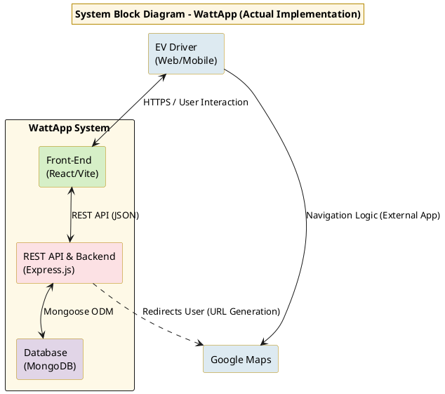
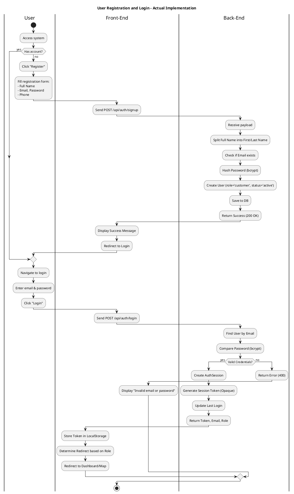
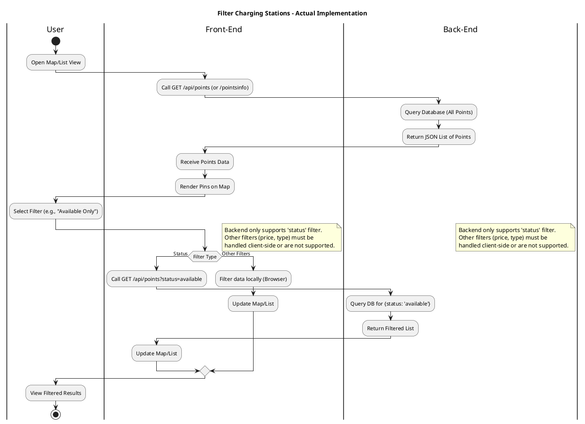
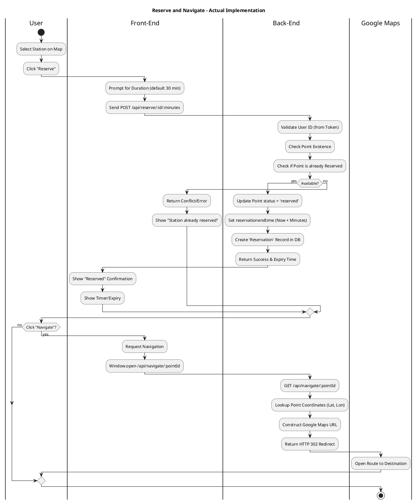
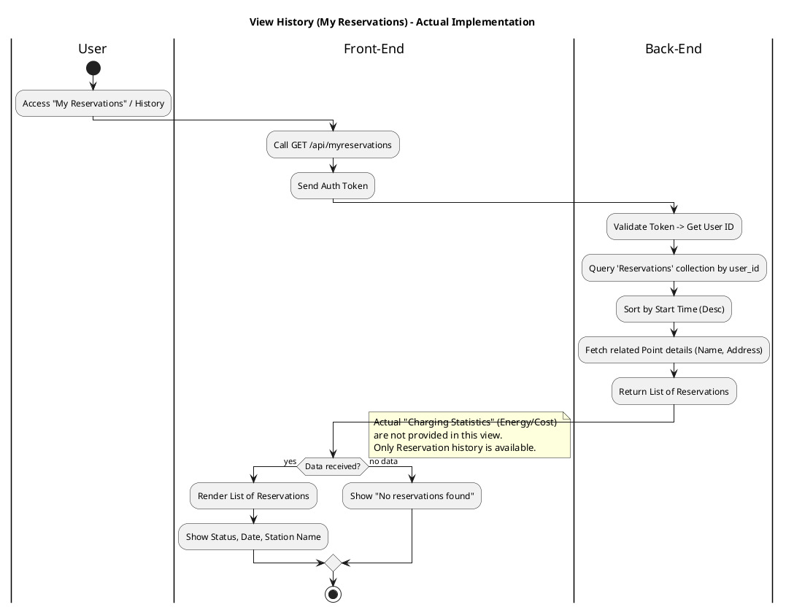
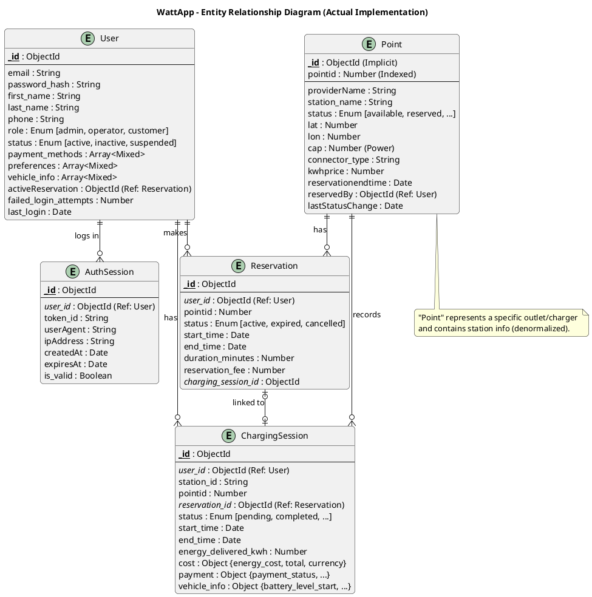

# Updated PlantUML Diagrams based on Actual Implementation

## 1. System Block Diagram
Reflects the actual architecture: Mongoose/MongoDB, Express Backend, React Frontend. External integrations like Payment Gateway are not active in the current codebase (simulated/storage only). Navigation is a direct redirection to Google Maps.

## 2. Use Case 1: Access Management
Reflects the actual authentication flow: No email verification, no 2FA, token-based session (Opaque Token stored in DB), name splitting logic on signup.

## 3. Use Case 2: Filter Charging Stations
Reflects the actual search capability: Backend supports filtering only by `status`. Other filtering (if any) is either not implemented or client-side. Map loading brings all points.

## 4. Use Case 3: Reserve and Navigate
Reflects the actual reservation logic (30-60 min limit, no payment check) and navigation (direct URL redirect).

## 5. Use Case 4: History & Statistics
Reflects the actual implementation: Users can view their "Reservations" (User History). "Charging Sessions" (Energy/Cost) are not directly linked to User View in the current API (Sessions endpoint is for admin/operator or requires point linkage).

## 6. Database ER Diagram (Actual Mongoose Schema)
Reflects the schemas defined in `models/`.

